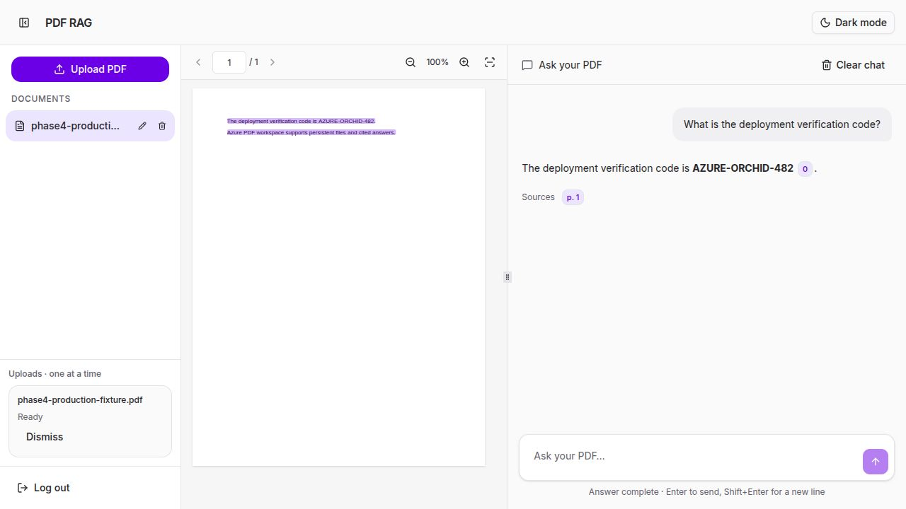
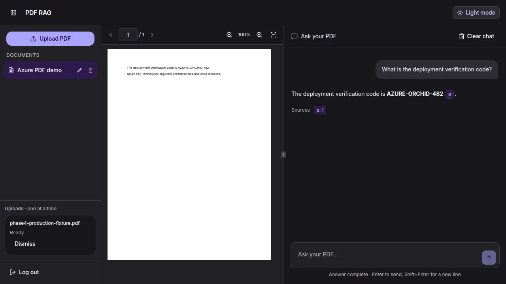
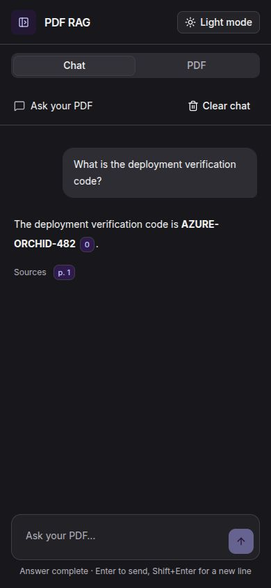
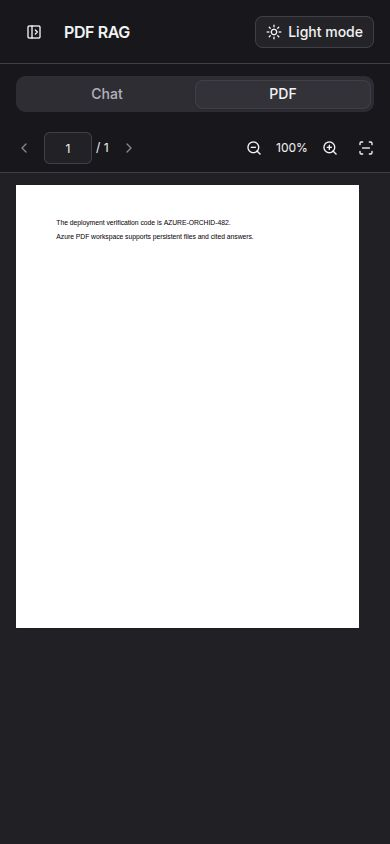
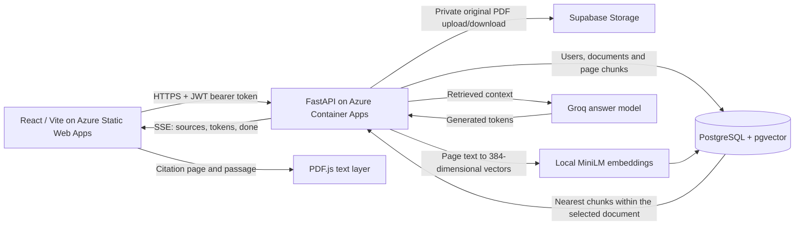

# PDF workspace

Read PDFs alongside a chat grounded in their contents, with page citations and a
responsive light/dark interface.

**Live app:** https://white-grass-09deb0b00.1.azurestaticapps.net

Click **Try the demo — no signup** to read the public sample, ask real questions,
and follow page citations. Sign in only when you want to upload your own PDFs.

The React/Vite frontend runs on Azure Static Web Apps. FastAPI runs on Azure
Container Apps, using PostgreSQL + pgvector, private Supabase PDF storage, local
MiniLM embeddings, and Groq for answers. Accounts and document operations are
owner-scoped.




## Features

- A no-signup guest demo with a public sample PDF, 20-minute sample-only sessions,
  and server-enforced read/chat permissions. Guest model calls share a rate limit.
- Multiple PDFs in a sequential upload queue with real transfer progress,
  indeterminate processing, failure messages, Retry/Dismiss, and safe response-loss
  reconciliation. Ingestion remains synchronous; extraction/embedding percentages
  are not simulated.
- Inline display-name rename and confirmed deletion, including durable storage
  cleanup and removal of the current document's browser-local conversation.
- Per-document local chat history, Markdown/code blocks, streaming answers,
  clickable page sources, passage highlighting, and a virtualized PDF viewer.
- Light/dark mode, a collapsible sidebar, resizable desktop panes and mobile tabs.



<p>
  
  
</p>

## Run locally

Configure the backend with `DATABASE_URL`, `JWT_SECRET_KEY`, `GROQ_API_KEY`, and
`FILE_STORAGE_BACKEND`. For Supabase originals, configure `SUPABASE_URL`,
`SUPABASE_SERVICE_ROLE_KEY`, and `SUPABASE_STORAGE_BUCKET`. Keep credentials private.

```bash
venv/bin/alembic upgrade head
venv/bin/uvicorn app.main:app --reload
```

In the frontend folder:

```bash
cd pdf-rag-frontend
npm ci
VITE_API_BASE_URL=http://localhost:8000 npm run dev
```

Production builds use the HTTPS API origin:

```bash
VITE_API_BASE_URL=https://pdf-rag-backend.lemontree-0d2266d5.centralindia.azurecontainerapps.io npm run build
```

`VITE_API_BASE_URL` is public configuration. Never put service credentials in a
Vite variable. The backend CORS allow-list includes the exact deployed frontend
origin. `public/staticwebapp.config.json` provides SPA fallback and worker/WASM
MIME types for Azure hosting; Vercel's existing fallback configuration is retained.

## Checks

```bash
PYTHONDONTWRITEBYTECODE=1 DATABASE_URL=sqlite:// JWT_SECRET_KEY=unit-test-only-secret \
  venv/bin/python -m pytest -q -p no:cacheprovider
cd pdf-rag-frontend
npm run test
npm run lint
npm run build
```

The backend suite now passes 128 tests (including guest authorization and evaluation tests). The release review separately exercised real
PostgreSQL upgrade/downgrade/upgrade, duplicate-name refusal, and recovery locks.
Production checks covered fresh accounts, owner isolation, upload/download,
rename/delete, streaming sources, and PDF persistence across an Express rolling
redeployment. Browser checks covered desktop/mobile layouts, PDF viewing,
citation highlighting and rename. Physical-device acceptance is still pending.

## API and operations

- [Guest demo setup and restrictions](docs/guest-demo.md)
- [Document management and migration](docs/document-management.md)
- [Page citation and SSE contract](docs/page-citations.md)
- [Frontend behavior and local checks](pdf-rag-frontend/README.md)

Uploads allow 10 MiB (10485760 bytes). Scanned PDFs need selectable text/OCR;
OCR is not implemented. Chat history is browser-local and is not synced across
accounts/devices. The UI does not expose server processing stages. Model output
can vary and should be checked against the cited original.

## Architecture



Uploads extract and chunk each physical PDF page, generate embeddings, and store
page metadata. Questions retrieve chunks only from the authenticated user's
selected document. Groq receives retrieved text, not the complete PDF. Citation
chips map chunk indexes to physical pages. Conversation history stays in browser
localStorage; it is not stored in PostgreSQL.

## Engineering evidence

- [Reproducible answer/citation evaluation](docs/evaluation.md)
- [Public-demo limits and cost audit](docs/public-demo-readiness.md)
- CI checks both backend and frontend on every branch push and pull request,
  including a real PostgreSQL migration round trip. It uses dummy CI credentials
  and never calls the production model or database.

The synthetic 24-question smoke evaluation recorded 23/24 expected-answer matches and 18/18 answerable citation-page hits. These are limited synthetic results, not general document accuracy; see the evaluation report for the recorded hallucination and methodology.
