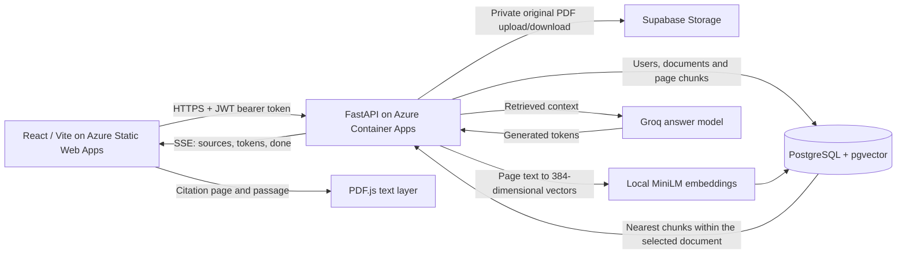

# PDF workspace

Read PDFs alongside a chat grounded in their contents, with page citations and a
responsive light/dark interface.

**Live app:** https://white-grass-09deb0b00.1.azurestaticapps.net

Click **Try the demo — no signup** to read the public sample, ask real questions,
and follow page citations. Sign in only when you want to upload your own PDFs.

The React/Vite frontend runs on Azure Static Web Apps. FastAPI runs on Azure
Container Apps, using PostgreSQL + pgvector, private Supabase PDF storage, local
MiniLM embeddings, and Groq for answers. Accounts and document operations are
owner-scoped.


## Features

- A no-signup guest demo with a public sample PDF, 20-minute sample-only sessions,
  and server-enforced read/chat permissions. Guest model calls share a rate limit.
- Multiple PDFs in a sequential upload queue with real transfer progress,
  indeterminate processing, failure messages, Retry/Dismiss, and safe response-loss
  reconciliation. Ingestion remains synchronous; extraction/embedding percentages
  are not simulated.
- Inline display-name rename and confirmed deletion, including durable storage
  cleanup and removal of the current document's browser-local conversation.
- Per-document local chat history, Markdown/code blocks, streaming answers,
  clickable page sources, passage highlighting, and a virtualized PDF viewer.
- Light/dark mode, a collapsible sidebar, resizable desktop panes and mobile tabs.


<p>
  
  
</p>

## Run locally

Requires Python 3.12, Node.js 22, Docker Compose, and your own Groq API key.

```bash
git clone https://github.com/ahmedforge/pdf-backend.git
cd pdf-backend
python3 -m venv .venv
. .venv/bin/activate
python -m pip install -r requirements.txt
cp .env.example .env
```

Edit `.env`: set a database password, a strong JWT secret, and your Groq key.
Match the password in `DATABASE_URL` to `POSTGRES_PASSWORD`. For a host-run API,
create the ignored `compose.local.yaml` file:

```yaml
services:
  db:
    ports:
      - "127.0.0.1:5432:5432"
```

```bash
docker compose -f compose.yaml -f compose.local.yaml up -d db
alembic upgrade head
uvicorn app.main:app --reload --host 127.0.0.1 --port 8000
```

In another terminal:

```bash
cd pdf-rag-frontend
npm ci
VITE_API_BASE_URL=http://localhost:8000 npm run dev
```

Open http://localhost:5173 and register to upload your own PDFs. The guest demo is
disabled locally until you explicitly configure a public sample; see
[guest demo setup](docs/guest-demo.md). The first embedding request may download
the MiniLM model. API reference: http://localhost:8000/docs.

`VITE_API_BASE_URL` is public configuration. Never put service credentials in a
Vite variable. Keep backend `CORS_ORIGINS` aligned with the exact frontend origin.
For Supabase originals, set `FILE_STORAGE_BACKEND=supabase`, `SUPABASE_URL`,
`SUPABASE_SERVICE_ROLE_KEY`, and `SUPABASE_STORAGE_BUCKET` on the backend only.
The Azure SPA fallback and worker/WASM MIME configuration is in
`pdf-rag-frontend/public/staticwebapp.config.json`.

## Checks

```bash
PYTHONDONTWRITEBYTECODE=1 DATABASE_URL=sqlite:// JWT_SECRET_KEY=local-test-only-secret-at-least-32-bytes-long \
  .venv/bin/python -m pytest -q -p no:cacheprovider
cd pdf-rag-frontend
npm run test
npm run lint
VITE_API_BASE_URL=https://api.example.com npm run build
```

The suite includes guest authorization, ingestion recovery, document ownership,
page citations, and evaluation scoring. The CI workflow also checks a PostgreSQL
migration round trip and runs frontend tests, lint, and a production build.
The [October 30 reconciliation checks](docs/reconciliation-checks.md) record the current local results.
Recorded deployment/browser checks in the linked guides are historical evidence,
not a claim that this update redeployed or re-tested the public service.

## API and operations

- [Guest demo setup and restrictions](docs/guest-demo.md)
- [Document management and migration](docs/document-management.md)
- [Page citation and SSE contract](docs/page-citations.md)
- [Frontend behavior and local checks](pdf-rag-frontend/README.md)

Uploads allow 10 MiB (10485760 bytes). Scanned PDFs need selectable text/OCR;
OCR is not implemented. Chat history is browser-local and is not synced across
accounts/devices. The UI does not expose server processing stages. Model output
can vary and should be checked against the cited original.

## Architecture



Uploads extract and chunk each physical PDF page, generate embeddings, and store
page metadata. Questions retrieve chunks only from the authenticated user's
selected document. Groq receives retrieved text, not the complete PDF. Citation
chips map chunk indexes to physical pages. Conversation history stays in browser
localStorage; it is not stored in PostgreSQL.

## Engineering evidence

- [Reproducible answer/citation evaluation](docs/evaluation.md)
- [Public-demo limits and cost audit](docs/public-demo-readiness.md)
- CI checks both backend and frontend on every branch push and pull request,
  including a real PostgreSQL migration round trip. It uses dummy CI credentials
  and never calls the production model or database.

The synthetic 24-question smoke evaluation recorded 23/24 expected-answer matches and 18/18 answerable citation-page hits. These are limited synthetic results, not general document accuracy; see the evaluation report for the recorded hallucination and methodology.
