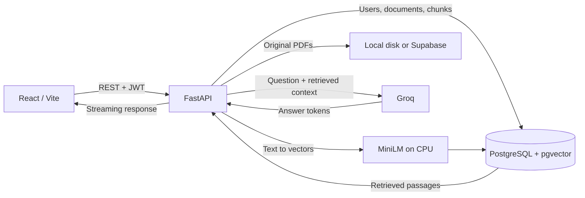

# PDF RAG Workspace

A full-stack document Q&A application: upload a text PDF, select it, and ask questions with streamed answers grounded in retrieved passages.

**React + FastAPI + PostgreSQL/pgvector + MiniLM + Groq**

[Hosted workspace](https://white-grass-09deb0b00.1.azurestaticapps.net/) · [Frontend setup](pdf-rag-frontend/README.md) · [Backend CI](https://github.com/ahmedforge/pdf-backend/actions)

The hosted workspace can be ahead of this branch. The features and setup below describe the source on `main`; they do not promise identical deployed behavior.

## What it does

- Register and sign in using JWT authentication; document API operations check ownership.
- Upload PDFs up to 10 MiB, extract selectable text, create chunks, and generate local MiniLM embeddings.
- Retrieve relevant passages from the selected document using PostgreSQL/pgvector and HNSW indexing.
- Ask questions using a JSON endpoint or streamed text response. The non-streaming response includes source previews; citations refer to chunk indexes.
- List, download, inspect, search, and delete your documents through the API.
- Store original PDFs locally or in a private Supabase bucket, with a persisted upload-recovery journal.

## Architecture



Uploads extract and embed text synchronously. Retrieval is scoped to the selected document after ownership validation. Groq receives the question and retrieved context; PDF originals use the configured storage backend. The current provider factory selects Groq; the Ollama module is not a selectable runtime option.

## Run locally

Requires Python 3.12, Node.js 22, and PostgreSQL with the pgvector extension. Docker Compose can provide the database.

```bash
git clone https://github.com/ahmedforge/pdf-backend.git
cd pdf-backend
python3 -m venv .venv
. .venv/bin/activate
python -m pip install -r requirements.txt
cp .env.example .env
```

Edit `.env`: choose a local database password and a strong JWT secret, and supply your own Groq API key. Match the password in `DATABASE_URL` to `POSTGRES_PASSWORD`. Keep `.env` private. For a host-run backend, publish PostgreSQL only to loopback with an override file:

```yaml
# compose.local.yaml
services:
  db:
    ports:
      - "127.0.0.1:5432:5432"
```

```bash
docker compose -f compose.yaml -f compose.local.yaml up -d db
alembic upgrade head
uvicorn app.main:app --reload --host 127.0.0.1 --port 8000
```

The first embedding request may download the model. The Dockerfile instead packages model weights at build time. In another terminal:

```bash
cd pdf-rag-frontend
npm ci
VITE_API_BASE_URL=http://localhost:8000 npm run dev
```

Open http://localhost:5173, register, upload a small selectable-text PDF, and ask a question. API reference: http://localhost:8000/docs. Liveness: http://localhost:8000/health/live.

`/health/ready` checks both the database and Groq access. Keep the frontend origin consistent with `CORS_ORIGINS`. `VITE_API_BASE_URL` is public configuration; model keys and storage credentials belong only on the backend.

## Verification

Use a disposable test database and dummy credentials when running tests; follow the PostgreSQL setup in [the CI workflow](.github/workflows/ci.yml).

```bash
PYTHONDONTWRITEBYTECODE=1 DATABASE_URL=sqlite:// JWT_SECRET_KEY=unit-test-only-secret \
  python -m pytest -q -p no:cacheprovider
cd pdf-rag-frontend
npm run lint
npm run build
```

The backend suite covers authentication, document access, retrieval behavior, storage, and ingestion recovery. CI runs migrations and backend tests against PostgreSQL/pgvector. Frontend lint/build are separate local checks; this branch has no frontend test script. A local run on October 28, 2026 passed all 55 tests using an in-memory SQLite database and mocked external services. This does not verify PostgreSQL migrations or live model quality; no broad RAG accuracy score is claimed here.

## Design choices and limits

- **Retrieval before generation:** the question is answered from selected passages, with chunk references. A valid chunk reference does not prove every generated claim is supported.
- **Durable originals:** local storage works for development; private object storage supports deployments with ephemeral disks.
- **Scope matters:** this branch has chunk references, not page-linked citations or a no-signup guest workflow.
- Scanned/image-only PDFs need OCR, which is not implemented. Upload processing is synchronous.
- The request limiter is in-process; it is not a shared limiter across replicas.
- Local-mode filenames share one storage directory and duplicate filenames can conflict. API ownership checks do not provide separate per-user filename namespaces.
- This is a portfolio application. Production use needs a separate review of security, retention, deployment behavior, and model costs.
